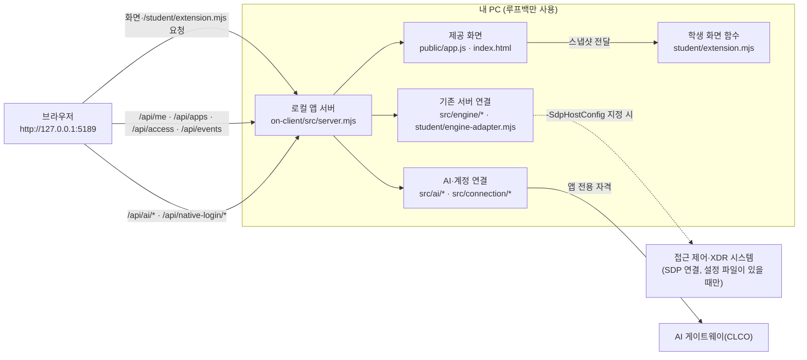

# 케셰브 학생용 실행 설명서와 시스템 구성도

이 문서는 학생(원석연)이 직접 작성한 설명서입니다. 제공 문서(`README.md`, `docs/STUDENT_LAUNCH_GUIDE.md` 등)는 수정하지 않았고, 이 문서가 그 내용을 이 프로젝트 기준으로 정리합니다. 아래 내용은 두 가지로 구분합니다.

- **코드·파일에서 확인**: 이 저장소의 파일 내용을 읽어서 확인한 것입니다. 명령을 실행해서 얻은 결과가 아닙니다.
- **실제 화면에서 확인**: 내 PC에서 앱을 켜고 직접 본 것입니다. 이 문서에서는 「내가 본 것」으로 따로 적습니다.
- **미확인**: 실행하지 않았거나 결과를 보지 못한 것입니다. 성공했다고 적지 않습니다.

## 1. 목적과 기능

케셰브는 회사 직원이 자기 로그인 상태, 업무 앱 접속 결과, 최근 접속 기록과 보안 경보를 보는 보안 Agent 앱입니다. 내 PC에서 로컬 서버를 켜고 브라우저로 열어 씁니다. (코드·파일에서 확인: `README.md`)

| 화면 기능 | 학생이 작성한 함수 | 하는 일 |
|---|---|---|
| 내 로그인·기기 | `renderIdentity` | 사용자·기기·세션 상태를 글자로 구분해 표시 |
| 업무 앱 접속 판정 | `renderDecision` | 허용·거부·추가 확인·확인 불가를 글자로 구분해 표시 |
| 보안 기록 | `renderEvents` | 접속·XDR 기록 목록과 근거·규칙·지원 조치를 표시 |
| 보호 현황 | `renderStatus` | 기기·세션·알림·진단 정보를 모아 표시 |
| AI 연결 | `renderAiConnection` | AI 연결·점검 상태와 오류 코드를 안내 |
| AI 설명 | `renderExplanation` | 기록 근거와 맞는 AI 설명만 표시, 맞지 않으면 쓰지 않음 |
| 조치 | `renderAction` | 조치 준비·접수·결과 상태를 표시(버튼·요청은 제공 화면이 담당) |
| 설치 패키지 취약점 | `renderVulnerabilities` | 패키지별 조회 상태와 취약점 ID를 표시 |

위 함수는 모두 `student/extension.mjs` 한 파일 안에 있고, 파일은 `createStudentView()`를 내보냅니다. (코드·파일에서 확인) 제공 화면(`public/app.js`)이 이 파일을 `/student/extension.mjs` 주소로 불러와 `createStudentView`가 함수가 맞는지 확인한 뒤 사용합니다. 불러오지 못하면 제공 화면이 「student/extension.mjs를 불러오지 못했습니다」 문구를 보여 줍니다. (코드·파일에서 확인: `public/app.js`)

## 2. 필요한 프로그램과 버전

| 항목 | 요구 | 근거 | 내 PC에서 확인한 값 |
|---|---|---|---|
| Windows PowerShell | 실행 도구가 `.ps1` | `tools/start-alekov.ps1` | 앱을 켜 본 PC에서 실행됨 (버전 번호는 미확인) |
| Node.js | `package.json`의 `engines.node`는 `24.19.0`. 실행 도구는 22~24만 통과시키고 24.19.0이 아니면 「참고」 문구만 표시 | `package.json`, `tools/start-alekov.ps1` | `node --version` 결과 `v24.21.0` (2026-10-28 내가 PowerShell에서 확인). 수업 기준 24.19.0과 다르지만 22~24 범위 안이라 실행 도구는 「참고」 문구만 표시합니다(코드 근거). 이 버전으로 앱을 켜서 13~20단계 화면을 확인했는지는 단계별로 따로 기록하지 않아 미확인 |
| 외부 npm 패키지 | 없음(`dependencies` 항목 없음). 잠금 파일(`package-lock.json`)도 `on-client` 폴더에 없음 | `package.json`, 폴더 목록 | 해당 없음 |
| Git, GitHub 저장소 | 커밋·제출용 | `docs/STUDENT_LAUNCH_GUIDE.md` 8장 | 저장소 `Nugury-code/KESHEV-Defense`, 브랜치 `master` |

지원하지 않는 환경: Node.js 22 미만과 25 이상은 실행 도구가 실행을 멈춥니다. (코드·파일에서 확인) macOS·Linux에서 실행해 본 적은 없고, 실행 도구가 PowerShell 스크립트이므로 지원 여부는 미확인입니다.

## 3. 폴더 구조

Git 저장소의 최상위는 `on-client`의 한 단계 위인 프로젝트 폴더입니다. 앱 폴더는 그 안의 `on-client`입니다. (코드·파일에서 확인: `docs/STUDENT_LAUNCH_GUIDE.md` 1장)

```text
케셰브-방어전/                 ← Git 최상위(여기서 git 명령을 실행)
└─ on-client/                  ← 앱 폴더(여기서 앱을 켬)
   ├─ package.json             ← 이름·버전(0.2.21)·node 요구 버전·npm 스크립트
   ├─ README.md                ← 제공 문서
   ├─ .env.example             ← 비밀 없는 설정 견본
   ├─ tools/start-alekov.ps1   ← 앱 실행 도구(제공)
   ├─ tools/prepare-native-host.ps1 ← 계정 연결 설정 준비(제공)
   ├─ src/server.mjs           ← 로컬 앱 서버(제공)
   ├─ src/ai/, src/connection/, src/engine/ ← AI 연결·계정 연결·기존 서버 연결(제공)
   ├─ public/                  ← 브라우저 화면(제공). index.html, app.js 등
   ├─ student/extension.mjs    ← 학생이 작성한 화면 함수(내 코드)
   ├─ student/engine-adapter.mjs ← 기존 서버 연결 어댑터(제공 견본, 수정하지 않음)
   └─ docs/                    ← 제공 문서와 이 설명서(STUDENT_RUNBOOK.md)
```

## 4. 실행 절차

1. 파일 탐색기에서 `on-client` 폴더를 엽니다.
2. 주소 표시줄에 `powershell`을 입력하고 Enter를 눌러 그 위치에서 PowerShell을 엽니다.
3. 아래 명령을 붙여 넣고 Enter를 누릅니다.

```powershell
powershell -NoProfile -ExecutionPolicy Bypass -File .\tools\start-alekov.ps1
```

4. 정상 시작 신호: 창에 다음 두 줄이 나옵니다. (코드·파일에서 확인: `tools/start-alekov.ps1`)
   - `케셰브가 켜졌습니다. 브라우저에서 http://127.0.0.1:5189/ 을 여세요.`
   - `서버가 응답한 것만 확인했습니다. AI 연결 상태는 화면에서 따로 확인해 주세요.`
5. 브라우저에서 `http://127.0.0.1:5189/`를 엽니다. 화면이 옛 상태로 보이면 `Ctrl+F5`로 새로 고칩니다.

내가 본 것: 이 명령으로 앱을 켜고 브라우저에서 화면을 열어 13~20단계 화면을 확인했습니다.

**`npm start`와의 차이.** `npm start`는 `node src/server.mjs`만 실행합니다(`package.json`). 실행 도구는 그 앞에서 계정 연결용 설정을 준비하고 `--native-host-config`를 서버에 넘깁니다(`tools/start-alekov.ps1`). 제공 `README.md`에는 「npm start도 같은 서버를 켭니다」라고 적혀 있으나, 내가 본 것은 `npm start`로는 AI 연결이 되지 않았고 위 실행 도구로 켰을 때만 AI 연결 칸이 동작했다는 것입니다. 이 문서의 실행 절차는 실행 도구를 기준으로 합니다.

실행 옵션(실행 도구에 정의된 것만): `-Port <1024~65535>`, `-Background`, `-Demo`, `-NoNativeHost`, `-NativeHostConfig`, `-SdpHostConfig`, `-WaitSeconds`. `-Port`와 `-Background` 외의 옵션은 내가 사용해 본 적이 없어 동작은 미확인입니다.

## 5. 종료와 다시 실행

- 종료: 앱을 켠 PowerShell 창에서 `Ctrl+C`. 이후 브라우저에서 주소가 열리지 않으면 종료된 것입니다.
- 다시 실행: 같은 `on-client` 폴더에서 4장의 명령을 다시 실행합니다.
- 코드(`student/extension.mjs`)를 고친 뒤: 서버는 요청마다 이 파일을 디스크에서 읽으므로(`src/server.mjs`의 `readFile`) 브라우저에서 `Ctrl+F5`로 다시 불러오면 새 코드가 보입니다. 서버를 다시 켜지 않고도 반영되는지는 내가 따로 시험하지 않아 미확인입니다. 반영되지 않으면 위 순서대로 서버를 껐다 다시 켭니다.
- `-Background`로 켠 경우: 창에 표시된 프로세스 번호의 `node`를 작업 관리자에서 종료합니다. 이 방법은 사용해 본 적이 없어 미확인입니다.

## 6. 시스템 구성도

### 글로 쓴 설명

브라우저는 내 PC의 로컬 앱 서버(`127.0.0.1:5189`, 루프백 주소만 사용)에만 요청합니다. 로컬 앱 서버(`src/server.mjs`)는 제공 화면 파일과 학생 파일(`student/extension.mjs`)을 내려 주고, `/api/…` 요청을 받아 두 갈래로 보냅니다. 하나는 접근 제어·XDR 시스템에 대한 조회(본인·기기·세션·업무 앱 접속 판정·보안 기록)이고, 다른 하나는 AI 요청입니다. AI 요청은 앱 전용 자격으로 AI 게이트웨이(CLCO)에 보내며, 브라우저는 AI 열쇠나 기존 서버 인증 비밀을 알지 못합니다. 학생 코드는 서버가 준 데이터를 화면에 그리는 일만 합니다. (코드·파일에서 확인: `docs/IMPLEMENTATION_CONTRACT.md`, `src/server.mjs`)

### Mermaid



### 표로 쓴 같은 내용

| 구간 | 보내는 것 | 담당 파일 | 상태 |
|---|---|---|---|
| 브라우저 → 로컬 앱 서버 | 화면 파일, `/api/…` 요청(같은 주소에서 온 요청만 허용) | `src/server.mjs` | 내가 본 것: 화면이 열림 |
| 로컬 앱 서버 → 학생 코드 | 서버가 준 데이터를 제공 화면이 `createStudentView()`의 함수에 전달 | `public/app.js`, `student/extension.mjs` | 내가 본 것: 13~20단계 화면이 그려짐 |
| 로컬 앱 서버 → 접근 제어·XDR 시스템 | 본인·앱·접속 판정·기록 조회 | `src/engine/*`, `student/engine-adapter.mjs` | 미확인: 연결 설정(`-SdpHostConfig`)으로 실제 시스템에 연결해 본 적 없음. 기본 실행은 「연결 없음」 |
| 로컬 앱 서버 → AI 게이트웨이 | 계정 연결 확인, AI 연결 점검, 사건 설명 요청 | `src/ai/*`, `src/connection/*` | 내가 본 것: 연결 시작·점검 요청까지. 점검 결과는 `ON_AI_PROVISIONING_PENDING`(운영자 준비 대기). AI 설명 성공은 미확인 |

## 7. 제공 코드와 학생 코드의 경계

| 구분 | 파일 | 수정 여부 |
|---|---|---|
| 학생이 작성 | `student/extension.mjs` | 13~20단계에서 함수를 작성함 |
| 학생이 작성 | `docs/STUDENT_RUNBOOK.md`(이 문서) | 21단계에서 새로 작성 |
| 제공(수정 안 함) | `src/**`(서버·AI·연결·엔진), `public/**`(화면), `tools/**`(실행 도구), `vendor/**` | 수정하지 않음 |
| 제공(수정 안 함) | `student/engine-adapter.mjs`, `.env.example`, `README.md`, 기존 `docs/*.md` | 수정하지 않음 |

학생 함수는 제공 화면이 넘긴 값을 `createElement`와 `textContent`로만 그립니다. 상태는 색뿐 아니라 글자로도 구분합니다. (코드·파일에서 확인: `student/extension.mjs`)

## 8. 확인한 기능과 미확인 기능

| 기능 | 코드 읽기 | 화면에서 확인 | ALEPH 제출 | 비고 |
|---|---|---|---|---|
| 서버 시작·화면 열기 | 확인 | 확인 | 해당 없음 | 실행 도구 기준 |
| 13~20단계 학생 함수 | 확인 | 단계마다 확인했다고 직접 보고 | 13~20단계 통과(내가 받은 결과 화면 기준) | 제출 판정은 서버 AI의 코드 읽기이며 실행이 아님 |
| 계정 연결·AI 연결 시작 | 확인 | 연결 화면까지 확인 | 해당 없음 | |
| AI 연결 점검 성공 | 확인 | **미확인** | 해당 없음 | 결과가 `ON_AI_PROVISIONING_PENDING`이었음 |
| AI 설명의 성공 화면(`renderExplanation`) | 확인 | **미확인** | 통과 | 위 점검 결과 때문에 실제 설명 응답을 받아 보지 못함 |
| 조치의 성공 화면(`renderAction`) | 확인 | **미확인** | 통과 | 연동 시스템이 지원하는 조치를 받아 본 적 없음 |
| 접근 제어·XDR 시스템(SDP) 실제 연결 | 확인 | **미확인** | 해당 없음 | 개인 설정 파일을 사용해 본 적 없음 |
| `-Demo`, `-NoNativeHost`, `-Background`, `-Port` 변경 | 확인 | **미확인** | 해당 없음 | 사용해 본 적 없음 |
| 설치형 앱 묶음(`npm run package-app`) | 확인하지 않음 | **미확인** | 해당 없음 | 사용하지 않음 |
| `npm run check`(문법 확인) | 확인 | **미확인** | 해당 없음 | 이 문서 작성 중 실행하지 않음 |

## 9. 문제가 생겼을 때 확인 순서

아래 표는 실제 코드의 오류 처리와 연결한 것입니다. 오류 코드는 `src/server.mjs`의 `safeErrors`와 `aiErrorMessages`, 실행 메시지는 `tools/start-alekov.ps1`에서 가져왔습니다. 자세한 코드별 안내는 `docs/CONNECTION_TROUBLESHOOT.md`에 있습니다.

### 9-1. 앱이 켜지지 않을 때 (PowerShell 창의 메시지)

| 메시지 | 원인 | 확인·복구 순서 |
|---|---|---|
| `Node.js 가 없습니다` | Node.js 미설치 | 1) `node --version` 실행 2) 없으면 Node.js 24.19.0 설치 3) PowerShell을 새로 열고 다시 실행 |
| `지금 Node.js 는 vXX 입니다` | 버전이 22~24 밖 | 22~24(권장 24.19.0)로 맞춘 뒤 다시 실행 |
| `포트 5189 를 다른 프로그램이 쓰고 있습니다` | 포트 충돌 | 다른 프로그램은 그대로 두고 명령 끝에 `-Port 5190`을 붙이고, 브라우저 주소도 `:5190`으로 엽니다. (`-Port`는 사용해 본 적이 없어 미확인) |
| `앱 폴더가 아닙니다` / `시작 틀 폴더가 아닙니다` | 실행 위치가 `on-client`가 아님 | `on-client` 폴더에서 PowerShell을 다시 엽니다 |
| `바로가기(링크)로 연결된 폴더…` | 링크로 연결된 폴더에서 실행 | 실제 `on-client` 폴더에서 실행 |
| `계정 연결 설정을 준비하지 못했습니다` | `prepare-native-host.ps1` 실패 | 창에 표시된 코드(`/` 뒤)를 기록하고, 기존 작업과 설정은 지우지 않습니다 |
| `…초 안에 뜨지 않았습니다` | 서버가 제때 응답하지 않음 | 창의 메시지 전체와 화면의 「도움정보」를 확인합니다 |

### 9-2. 화면에서 오류 코드가 보일 때

| 코드 | 의미(코드의 안내 문구 기준) | 확인 순서 |
|---|---|---|
| `ENGINE_NOT_CONNECTED` | 기존 서버·에이전트 연결이 없음 | 이 실행에 `-SdpHostConfig`를 넣었는지 확인. 넣지 않았다면 기본 실행의 「연결 없음」이며 고장이 아님 |
| `SUBJECT_SCOPE_UNVERIFIED` | 현재 로그인과 사건·프로젝트의 연결을 확인할 수 없음 | 정상으로 보지 말고 SDP 설정·로그인 상태 확인 |
| `ENGINE_RESULT_UNVERIFIED` / `ENGINE_TIMEOUT` | 서버 응답을 확인할 수 없음 / 응답 시간 초과 | 정상이나 빈 결과로 보지 않고, 직접 한 번 다시 조회 |
| `ON_AI_PROVISIONING_PENDING` | 앱 전용 AI 이용 권한이 준비되지 않았거나 확인 불가 | 계정 연결·앱 승인 상태 확인. 운영자 준비가 끝날 때까지 AI 점검은 성공으로 쓰지 않음(내가 본 상태) |
| `WB_CLCO_RATE_LIMITED`, `WB_CLCO_TIMEOUT`, `WB_CLCO_NETWORK_ERROR`, `WB_CLCO_SERVER_UNAVAILABLE` | AI 요청 제한·시간 초과·네트워크·서버 연결 문제 | 인터넷 연결 확인 후 잠시 뒤 직접 한 번 다시 시도(자동 재시도는 없음) |
| `HOST_REJECTED`, `ORIGIN_REJECTED`, `QUERY_REJECTED` | 허용되지 않은 주소·출처·쿼리 | 브라우저 주소를 `http://127.0.0.1:포트/`로 열었는지 확인 |
| `SERVICE_UNAVAILABLE` | 연결 상태를 확인할 수 없음(그 밖의 모든 오류) | 잠시 뒤 직접 다시 시도, 계속되면 도움정보 확인 |
| `REQUEST_TIMEOUT`, `REQUEST_CANCELLED` | 요청 시간 초과·연결 종료로 취소 | 연결 상태 확인 후 직접 다시 시도 |

공통 원칙: 예제(demo)·연결 없음·확인 불가를 성공으로 보지 않습니다. 오류를 해결한다고 작업 폴더나 커밋을 지우지 않습니다.

## 10. 비밀 정보 취급

- 이 문서와 저장소에는 열쇠·토큰·비밀번호·인증서를 적지 않았습니다. (코드·파일에서 확인: 이 문서에 해당 값 없음)
- `.env.example`에는 비밀 없는 설정(`ON_PORT`, `ON_ENGINE_ADAPTER`, `ON_AI_MODEL` 등)만 있습니다.
- 계정 연결 설정은 실행 도구가 프로젝트 밖의 Windows 사용자 폴더에 자동으로 준비합니다. 그 내용은 이 저장소에 들어 있지 않으며 열어 보지 않았습니다.
